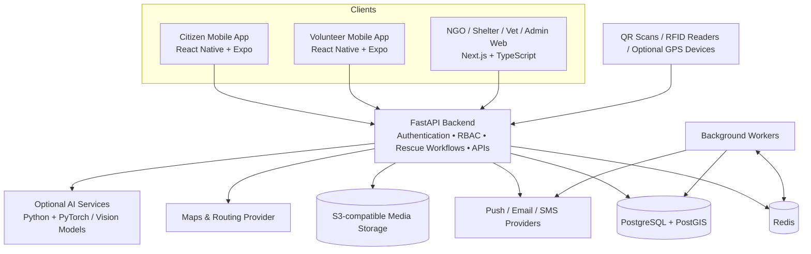

# RESCREW — Animal Rescue Intelligence Platform

RESCREW is an AI-enabled animal rescue coordination platform designed to connect citizens, NGOs, rescue volunteers, veterinary clinics, and animal shelters through a connected multi-NGO network.

The initial pilot is planned for Goa, with an architecture intended to support expansion across India.

> **Project status:** This repository is at the architecture and foundation stage. The technology choices and modules below describe the planned system; they should not be interpreted as already implemented or production-ready.

## Mission

Make animal rescue more coordinated, traceable, and accessible by connecting emergency reporting, NGO verification, volunteer dispatch, animal identification, shelter placement, and medical follow-up in one system.

## Core workflow

1. **Animal SOS reporting** — A citizen submits photos, GPS location, animal condition, and a short description.
2. **NGO notification and verification** — Relevant registered NGOs and coordinators review the report, verify details, and prioritize the response.
3. **Smart rescue coordination** — The platform helps coordinators identify suitable teams using distance, estimated travel time, availability, skills, vehicles, equipment, and urgency.
4. **GPS-based rescue** — Volunteers receive navigation details and update the case as they travel, arrive, begin rescue, and complete or hand over the operation.
5. **Animal identification** — Each animal receives a permanent RESCREW Animal ID. QR codes and registered RFID microchip numbers can link to its digital profile.
6. **Shelter management** — NGOs identify suitable facilities based on species acceptance, capacity, and care requirements, then confirm admission.
7. **Medical records and case tracking** — Authorized veterinary and shelter teams maintain diagnosis, treatment, vaccination, recovery, placement, and follow-up records.
8. **Multi-NGO coordination and escalation** — Authorized organizations can coordinate transfers and escalate urgent cases when no eligible team accepts them.
9. **Lost-and-found and reunification** — Verified animal identity records can help reunite lost animals with owners.
10. **Reports and welfare follow-ups** — Dashboards track response, rescue outcomes, shelter capacity, and post-rescue care.

## Planned technology stack

| Layer | Planned technology | Responsibility |
|---|---|---|
| Web frontend | Next.js + TypeScript | NGO coordinator, shelter, veterinary, and administration portals |
| Mobile apps | React Native + Expo | Citizen reporting and volunteer/responder workflows |
| Backend API | Python + FastAPI | Authentication, permissions, rescue workflows, coordination, and integrations |
| Primary database | PostgreSQL | Users, organizations, incidents, animals, cases, medical records, and audit data |
| Geospatial database | PostGIS | Nearby NGO/team/shelter queries, geofencing, and spatial filtering |
| Cache and background work | Redis + background workers | Caching, queued notifications, and asynchronous processing |
| Media storage | S3-compatible object storage | Animal photos, rescue evidence, and authorized documents |
| Maps and routing | Google Maps Platform (initial option) | Maps, navigation, distance, and ETA |
| AI services | Python, PyTorch, and evaluated vision models (YOLO as a candidate) | Future image assistance and triage support |
| Notifications | Firebase Cloud Messaging plus configured email/SMS providers | Push alerts, OTP, and operational notifications |
| Deployment | Docker; cloud hosting on AWS or Google Cloud (to be selected) | Reproducible services and hosting |
| Engineering workflow | GitHub and GitHub Actions | Source control, reviews, and CI/CD |
| Monitoring | Sentry (planned) | Application error monitoring |

Technology choices may be revised after validating cost, data protection, availability, and pilot requirements.

## High-level architecture



### Architecture principles

- **One shared backend:** Web and mobile clients use the same FastAPI services and authorization rules.
- **Multi-organization by design:** A connected NGO network supports organization membership, scoped access, authorized collaboration, and recorded handovers.
- **Separate domain concepts:** An *Incident* is a report, an *Animal* is a persistent identity, and a *Case* is a coordinated rescue operation. One incident may involve multiple animals.
- **Location-aware, not location-dependent:** GPS coordinates and PostGIS support rescue operations; manual location correction and address/landmark details should remain available.
- **Offline-aware field workflows:** The responder app is planned to cache assigned tasks and queue permitted updates for synchronization when connectivity returns.
- **Human oversight:** AI may assist with classification or prioritization but should not independently diagnose animals, assign high-risk cases, or submit reports without appropriate human review.
- **Privacy and accountability:** Role-based access, organization scoping, consent, audit events, secure media access, and retention rules are foundational requirements.

## Animal identification and location

RESCREW will distinguish identification from tracking:

- **RESCREW Animal ID:** The permanent platform-level identity for every registered animal.
- **QR code:** A scannable tag that opens an appropriately protected animal profile or public contact flow.
- **RFID microchip:** A registered chip identifier read using a compatible RFID/microchip scanner. A typical implanted identification microchip is not a GPS tracker and does not provide live location.
- **GPS tracking:** Live location is only available when a separate GPS-enabled collar/device is fitted, powered, connected, and authorized. It is an optional capability, not a feature of the RFID chip.

## Core domain model (planned)

The data model will be designed around these distinct entities:

- **Identity and access:** Users, sessions, organizations, memberships, roles, and permissions.
- **Facilities and capacity:** Facilities, shelter spaces, and capacity/availability records.
- **Animal registry:** Animals, animal identifiers (RESCREW ID, QR token, RFID/microchip ID), and authorized profile links.
- **Reporting and operations:** Incidents, incident-animal links, cases, case-animal links, assignments, case events, and handovers.
- **Care and placement:** Medical/care records, placements, and follow-up records.
- **Supporting services:** Media assets and links, consent records, notifications and delivery attempts, audit events, and AI request/result records.

This is a conceptual domain outline, not a finalized SQL schema. Relationships, constraints, retention policies, and migration files will be documented before implementation.

## Security and privacy baseline

- Role-based access control for citizens, NGO coordinators, volunteers, veterinarians, shelter staff, and administrators.
- Organization-scoped access with explicit authorization for cross-NGO collaboration and handovers.
- No public exposure of private owner, volunteer, medical, or sensitive location details.
- Secure handling of authentication secrets and environment variables; never commit API keys or credentials.
- Audit important actions such as verification, assignment, status changes, profile merges, record access where appropriate, and handovers.
- Validate uploads and restrict access to media through controlled storage URLs.
- Define consent, data retention, backup, and deletion policies before production deployment.

## Suggested repository structure

```text
rescrew-animal-rescue-platform/
├── frontend/
│   ├── web/                  # Next.js web portals
│   └── mobile/               # React Native + Expo apps
├── backend/
│   ├── app/                  # FastAPI application
│   └── tests/
├── database/
│   ├── migrations/
│   ├── schemas/
│   └── seeds/
├── ai-services/
│   ├── vision/
│   └── triage/               # Human-reviewed decision support
├── infrastructure/
│   ├── docker/
│   └── deployment/
├── docs/
│   ├── architecture/
│   ├── api/
│   └── data-model/
├── .env.example
├── .gitignore
└── README.md
```

Directories are a proposed organization and can be added as implementation begins.

## Development roadmap

### Phase 1 — Foundation and MVP
- Repository conventions, architecture decisions, and environment setup.
- Database schema and migrations.
- Authentication, user roles, organization membership, and NGO verification.
- Citizen SOS reporting and NGO verification queue.
- Basic assignment, rescue status updates, and notifications.

### Phase 2 — Rescue operations
- Location-aware team matching and navigation.
- Shelter discovery, capacity checks, admission, and handover.
- Animal registry with RESCREW IDs, QR codes, and RFID identifier support.
- Medical and care records.

### Phase 3 — Reliability and intelligence
- Offline-first responder updates and synchronization.
- Escalation, duplicate report suggestions, and lost-and-found workflows.
- Analytics, welfare follow-ups, and audit reporting.
- Carefully evaluated AI-assisted image classification and triage.

### Phase 4 — Expansion
- Disaster and mass-rescue operations.
- Additional regions and partner organizations.
- Optional GPS tracking device integrations and wider ecosystem integrations.

## Getting started

Implementation has not yet been scaffolded. Setup instructions will be added alongside the first working frontend and backend services.

When implementation begins, local configuration should be stored in environment files that are excluded from version control. Use `.env.example` for documented variable names without real secrets.

## Contribution approach

1. Create a feature branch from `main`.
2. Keep changes focused and document architectural decisions.
3. Add tests for API behavior, permissions, and critical rescue workflows.
4. Open a pull request describing the change, testing performed, and any data-model impact.
5. Never commit credentials, private animal/owner data, or real rescue evidence.

## License

No open-source license has been selected yet. Until a license is added, standard copyright applies and reuse should not be assumed to be permitted.
